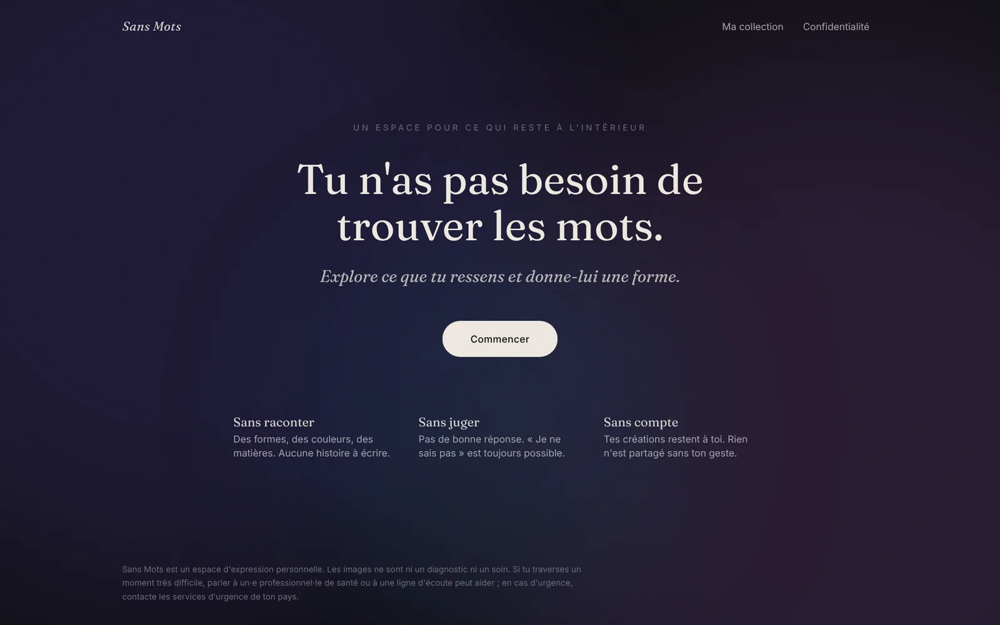
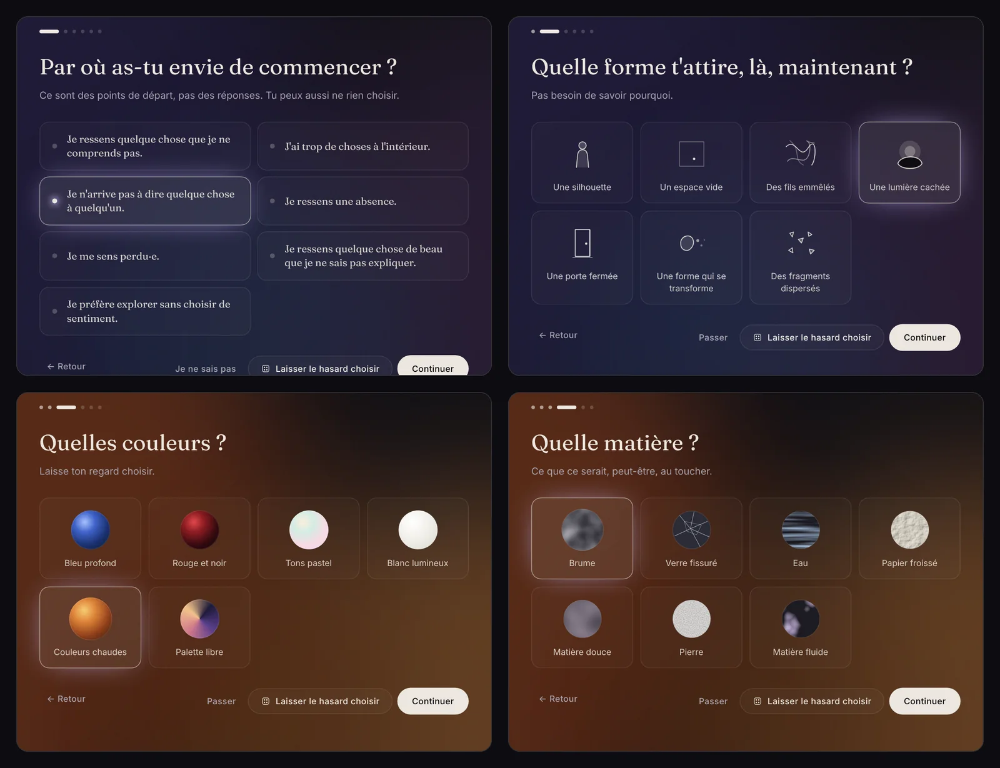
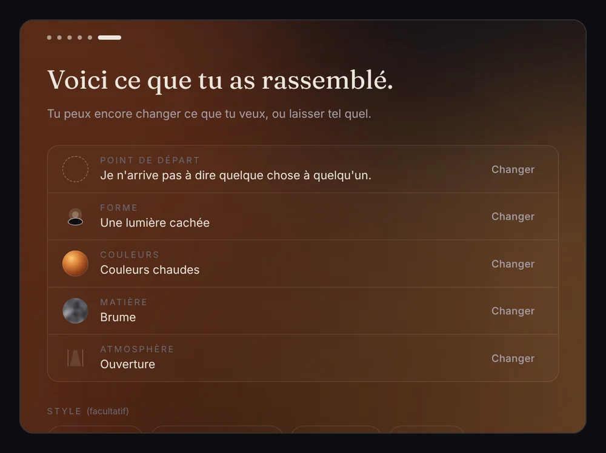
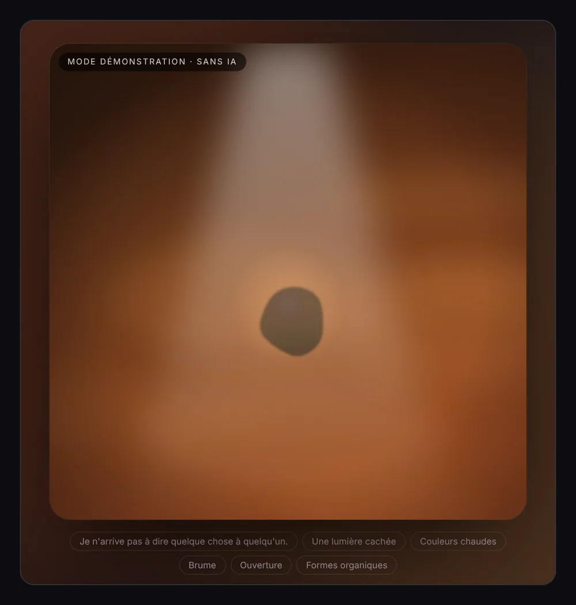
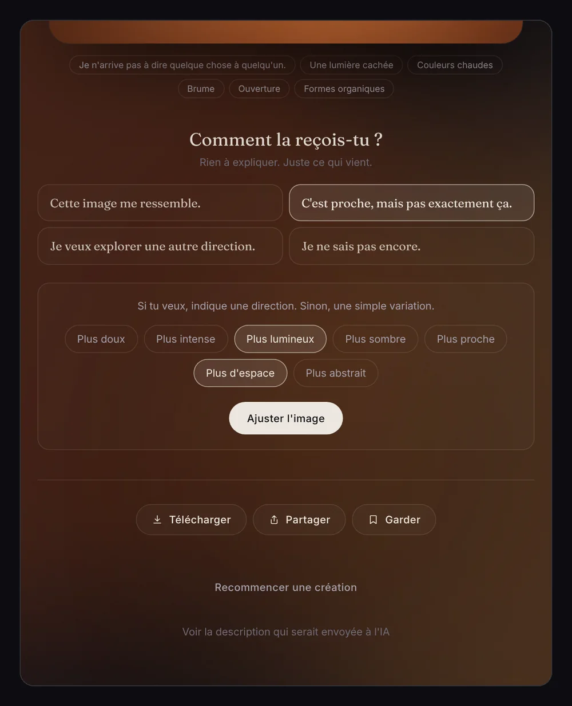
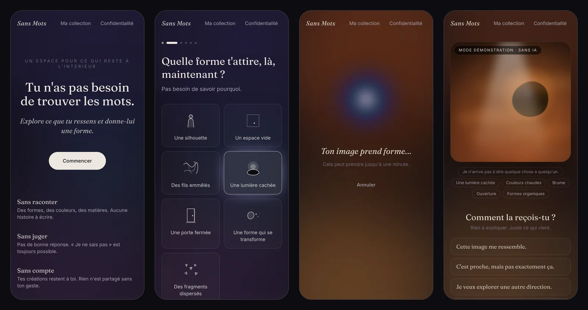
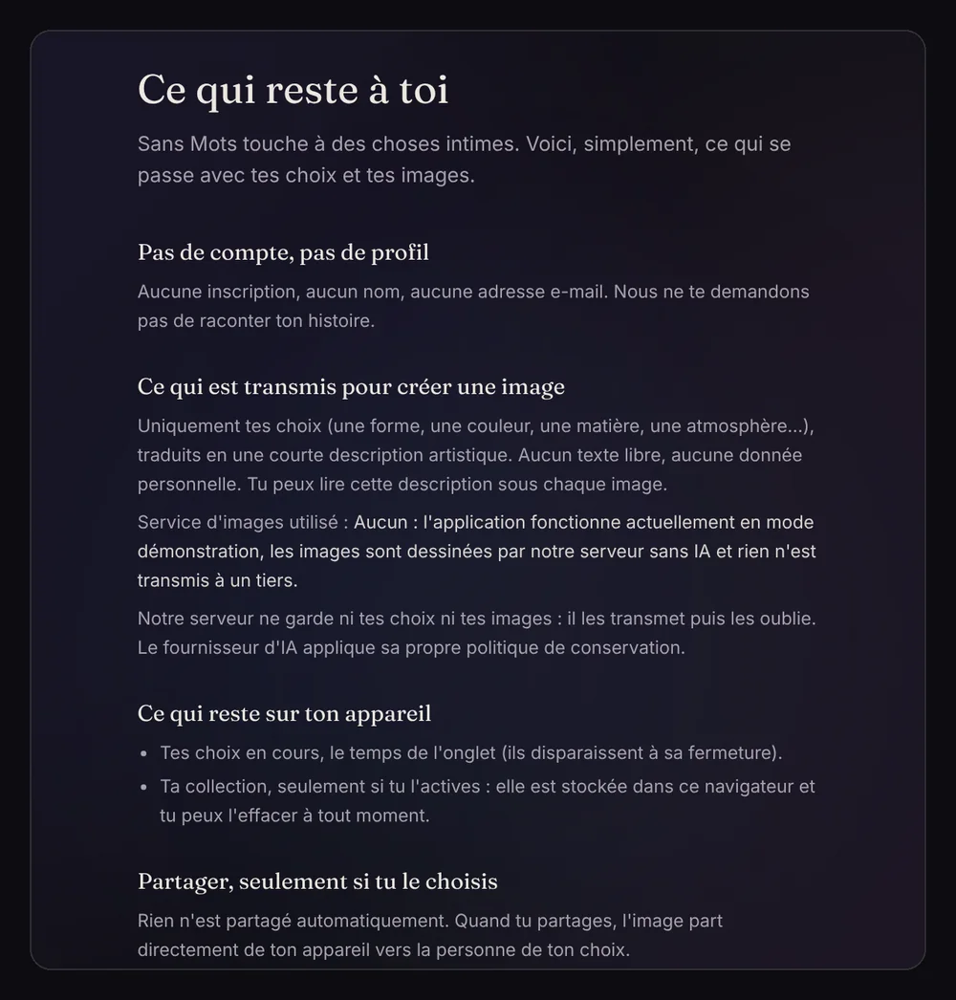
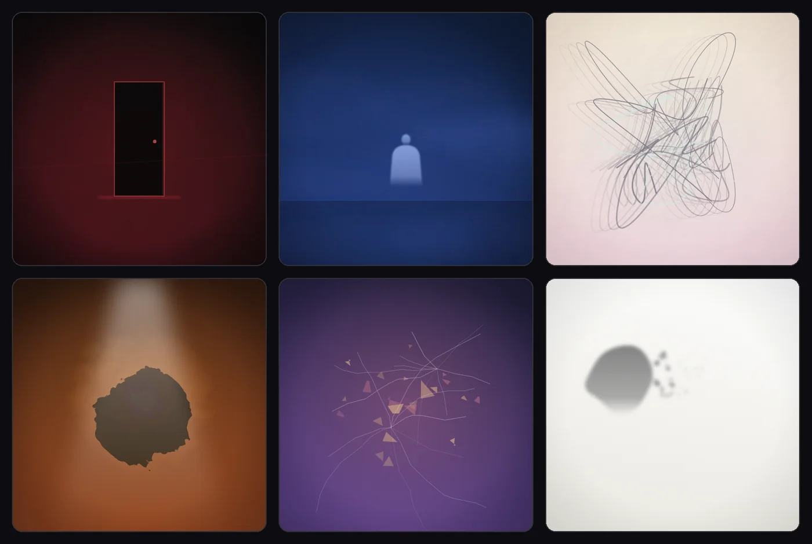
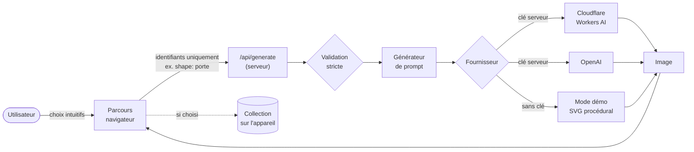

<div align="center">

# Sans Mots

### *Tu n'as pas besoin de trouver les mots.*

**Une application web qui aide à exprimer ce que l'on ressent, sans avoir à l'expliquer :
quelques choix sensibles, et l'IA leur donne une forme.**

[**Essayer en ligne →**](https://image-me-chi.vercel.app)




</div>

---

> **English summary.** *Sans Mots* ("Without Words") helps people express feelings they
> can't put into words. Instead of writing, users pick a starting point, a shape, colours,
> a texture and an atmosphere. The app turns these intuitive choices into an artistic
> prompt and generates a personal image with AI (Cloudflare Workers AI or OpenAI). No
> account, nothing shared without consent, private by default. The interface is in French.

---

## Sommaire

- [L'idée](#lidée)
- [Le parcours en images](#le-parcours-en-images)
- [Fonctionnalités](#fonctionnalités)
- [Démarrer en local](#démarrer-en-local)
- [Activer la génération par IA](#activer-la-génération-par-ia)
- [Mettre en ligne gratuitement](#mettre-en-ligne-gratuitement)
- [Comment ça marche](#comment-ça-marche)
- [Confidentialité et sécurité émotionnelle](#confidentialité-et-sécurité-émotionnelle)
- [Qualité et tests](#qualité-et-tests)
- [Structure du projet](#structure-du-projet)
- [Feuille de route](#feuille-de-route)
- [Auteurs](#auteurs)

---

## L'idée

Certaines émotions sont fortes, complexes ou confuses. On les ressent sans savoir les
nommer, ou sans réussir à en parler, même à ses proches.

**Sans Mots** propose un autre chemin : au lieu d'écrire, on choisit, presque à
l'instinct, des formes, des couleurs, des matières et des atmosphères. L'IA en fait une
image artistique personnelle, qui suggère plus qu'elle n'affirme.

> **Ne pas traduire les émotions à la place des personnes, mais leur donner les moyens
> de les exprimer.**

Il ne s'agit pas de deviner une émotion. Il s'agit d'aider quelqu'un à trouver une forme
qui lui ressemble, à la garder, ou à la montrer à quelqu'un de confiance.

---

## Le parcours en images

### 1. Explorer, sans devoir nommer

Cinq étapes courtes, sans questionnaire. Chacune propose aussi **« Passer »** (ou
« Je ne sais pas ») et **« Laisser le hasard choisir »**. Le fond prend doucement les
couleurs choisies.

<p align="center">
  
</p>

### 2. Rassembler, puis créer

Un récapitulatif où tout reste modifiable, avec un style artistique facultatif.
Ne rien choisir du tout fonctionne aussi : l'image part alors d'un espace ouvert.

<p align="center">
  
</p>

### 3. Recevoir l'image, sans avoir à se justifier

L'image apparaît lentement. L'utilisateur réagit en un geste, sans jamais devoir
expliquer pourquoi : *« Cette image me ressemble »*, *« C'est proche, mais pas
exactement ça »* (avec des ajustements facultatifs), *« Je veux explorer une autre
direction »*, ou *« Je ne sais pas encore »*.

<p align="center">
  
  &nbsp;
  
</p>

### 4. Sur mobile

Une interface pensée d'abord pour le téléphone.

<p align="center">
  
</p>

### 5. Transparence

Une page explique en clair ce qui est transmis, ce qui reste sur l'appareil, et ce
que l'application ne fait pas.

<p align="center">
  
</p>

> **Note sur les captures.** Elles ont été réalisées en **mode démonstration** (badge
> « Mode démonstration · sans IA »). Dans ce mode, les images sont dessinées de façon
> procédurale, sans IA, comme ci-dessous. Avec un fournisseur configuré, ce sont de
> vraies images générées par IA.
>
> 

---

## Fonctionnalités

| | |
|---|---|
| **Parcours guidé** | 7 points de départ (dont « explorer sans choisir de sentiment »), 7 formes, 6 palettes, 7 matières, 7 atmosphères, 6 styles artistiques |
| **Toujours une issue** | « Passer », « Je ne sais pas », « Laisser le hasard choisir » à chaque étape ; le hasard indique ensuite ce qu'il a choisi |
| **Prompt artistique** | Généré à partir des choix : sujet, ressenti suggéré (jamais littéral), matière, palette, atmosphère, composition, intensité, garde-fous |
| **Génération par IA** | Cloudflare Workers AI (FLUX.1 schnell, offre gratuite) ou OpenAI (`gpt-image-1`), interchangeables |
| **Mode démonstration** | Sans clé API : images procédurales clairement signalées « sans IA » |
| **Ajuster** | Variations, avec les nuances plus doux / intense / lumineux / sombre / proche / d'espace / abstrait ; retour à l'image précédente |
| **Garder** | Téléchargement en PNG, collection privée sur l'appareil (désactivée par défaut) |
| **Partager** | Volontairement, via la feuille de partage du téléphone, avec un mot facultatif |
| **Robustesse** | Annulation, réessai, messages d'erreur doux, limite de débit, choix conservés le temps de l'onglet |
| **Accessibilité** | Navigation au clavier, lecteurs d'écran, focus visible, mouvements réduits respectés |

---

## Démarrer en local

**Prérequis :** Node.js 20.9 ou plus récent (22 recommandé).

```bash
git clone https://github.com/HichemHa/ImageMe.git
cd ImageMe
npm install
npm run dev
```

Ouvrir <http://localhost:3000>. Sans configuration, l'application démarre en **mode
démonstration**.

---

## Activer la génération par IA

```bash
cp .env.example .env.local
```

Renseigner **un** des deux fournisseurs :

| Fournisseur | Coût | Variables |
|---|---|---|
| **Cloudflare Workers AI** (FLUX.1 schnell) | **Gratuit** dans la limite d'un quota quotidien | `CLOUDFLARE_ACCOUNT_ID`, `CLOUDFLARE_API_TOKEN` |
| **OpenAI** (`gpt-image-1`) | Payant à l'image | `OPENAI_API_KEY` |

Le fournisseur est détecté automatiquement, dans cet ordre : Cloudflare, puis OpenAI,
puis le mode démonstration. Pour le forcer : `IMAGE_PROVIDER=cloudflare|openai|demo`.
Toutes les variables sont décrites dans [`.env.example`](.env.example).

> 🔐 Les clés restent **côté serveur**. Ne jamais les préfixer par `NEXT_PUBLIC_`, ne
> jamais les committer, ne jamais les partager.

---

## Mettre en ligne gratuitement

**Vercel** (plan Hobby) héberge le site, et **Cloudflare Workers AI** génère les images.
Les deux sont gratuits, et aucune base de données n'est nécessaire.

1. Importer le dépôt sur [vercel.com](https://vercel.com) (*Add New → Project*).
   Next.js est détecté automatiquement.
2. Ajouter `CLOUDFLARE_ACCOUNT_ID` et `CLOUDFLARE_API_TOKEN` dans
   *Settings → Environment Variables*.
3. Déployer. Chaque `git push` sur `main` redéploie ensuite le site.

Le guide pas à pas, avec la création du jeton Cloudflare et le diagnostic des erreurs,
se trouve dans [**docs/DEPLOIEMENT.md**](docs/DEPLOIEMENT.md).

---

## Comment ça marche



- **Aucun texte libre n'est envoyé à l'IA :** seulement des identifiants issus d'un
  catalogue, vérifiés par le serveur. Cela protège la vie privée et empêche l'injection
  de prompt.
- **Le prompt est construit côté serveur.** Exemple, pour *« quelque chose que je ne
  peux pas expliquer + silhouette + verre fissuré + bleu profond + silence »* :

  > *An evocative artwork in the style of poetic fine-art photography… Main subject: a
  > solitary, anonymous human silhouette with no visible face. The image quietly evokes
  > an undefined inner sensation that is hard to name, suggested through mood rather
  > than shown literally. Material and texture: cracked glass… Color palette: deep blue,
  > indigo and midnight tones. Atmosphere: silent and still… No text… Leave room for
  > interpretation.*

- **Les fournisseurs sont interchangeables** derrière une interface commune : ajouter un
  fournisseur revient à écrire un seul fichier.

Les détails (décisions techniques, contrat d'API, ajout d'un fournisseur) se trouvent
dans [**docs/ARCHITECTURE.md**](docs/ARCHITECTURE.md).

---

## Confidentialité et sécurité émotionnelle

Ce projet touche à l'intime. Les règles suivantes sont intégrées au code, pas
seulement écrites :

- **Aucun compte, aucune donnée personnelle demandée.** Personne n'a à raconter son
  histoire.
- **Seuls des mots-clés sont transmis** au fournisseur d'IA. La description envoyée est
  consultable sous chaque image.
- **Le serveur ne conserve rien.** Les choix en cours vivent dans l'onglet
  (`sessionStorage`) et disparaissent à sa fermeture.
- **La collection est privée et désactivée par défaut.** Elle est stockée dans le
  navigateur (IndexedDB) et peut être effacée à tout moment.
- **Rien n'est partagé automatiquement.** Le partage passe directement de l'appareil à
  la personne choisie.
- **Pas de diagnostic.** L'application ne prétend pas connaître les émotions, et elle
  oriente vers des professionnel·le·s ou les services d'urgence si besoin.

---

## Qualité et tests

```bash
npm test           # Vitest : prompts, hasard, validation, fournisseurs, API, limite de débit
npm run lint       # ESLint
npm run typecheck  # TypeScript strict
npm run build      # build de production
```

Les tests couvrent le générateur de prompts, la résolution du hasard, le rejet de tout
texte libre, la sélection du fournisseur, les appels Cloudflare et OpenAI (réponses
simulées), toutes les combinaisons du mode démonstration, la route `/api/generate` et le
limiteur de débit. Le parcours complet a aussi été vérifié dans un navigateur sans
interface, sur mobile et sur ordinateur.

---

## Structure du projet

```
src/
├── app/
│   ├── page.tsx                 Accueil
│   ├── creer/                   Parcours de création
│   ├── collection/              Collection privée (sur l'appareil)
│   ├── confidentialite/         Ce qui est transmis, ce qui reste
│   └── api/generate/route.ts    Génération : validation, limite, erreurs
├── components/
│   ├── experience/              Étapes, récapitulatif, attente, résultat
│   ├── ChoiceGrid.tsx           Choix accessibles (boutons radio)
│   ├── OptionVisual.tsx         Vignettes abstraites des options
│   ├── ImageActions.tsx         Télécharger, partager, garder
│   └── AmbientBackground.tsx    Fond d'ambiance réactif
└── lib/
    ├── options.ts               Catalogue des choix + fragments de prompt
    ├── selection.ts             Hasard reproductible, validation des requêtes
    ├── prompt.ts                Générateur de prompts artistiques
    ├── providers/               cloudflare · openai · demo (interface commune)
    ├── collection.ts            IndexedDB
    └── image-utils.ts           Téléchargement et partage (SVG → PNG)
tests/                           Vitest
docs/                            Architecture, déploiement, captures
```

---

## Feuille de route

**Volontairement absent du MVP :** réseau social, profils publics, likes, suivi
émotionnel, analyse psychologique, abonnement.

**Pistes pour la suite :**
- [ ] Limite de débit partagée entre instances (Vercel KV / Upstash Redis)
- [ ] Tests end-to-end automatisés (Playwright) en intégration continue
- [ ] Choix multiples par étape (deux couleurs, deux atmosphères…)
- [ ] Interface multilingue (anglais, arabe)
- [ ] Nom définitif (*Sans Mots* est un nom de travail, à vérifier juridiquement)

---

## Auteurs

| | Rôle |
|---|---|
| **[Hichem](https://github.com/HichemHa)** | Idée, vision du projet, direction produit et artistique, déploiement |
| **Claude** (Anthropic), via Claude Code | Conception technique, développement, tests et documentation, en binôme avec Hichem |

Ce projet est né d'une collaboration entre une personne et une IA : la vision et les
choix sont humains, l'écriture du code a été partagée.

---

<div align="center">

*Sans Mots est un espace d'expression personnelle. Les images ne sont ni un diagnostic
ni un soin.*

</div>
