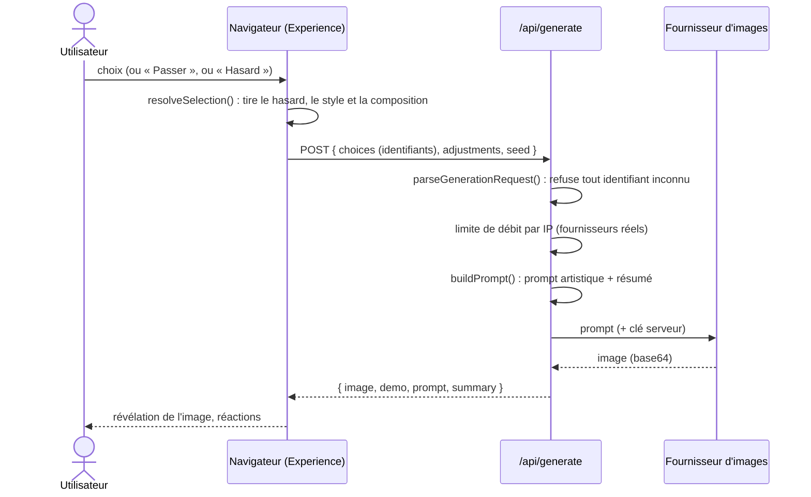
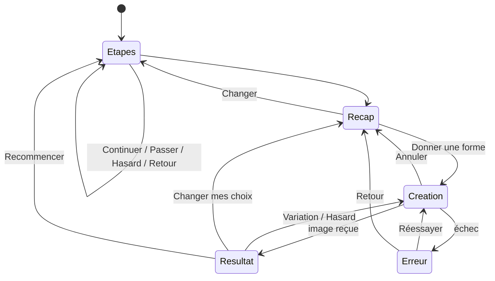

# Architecture

Ce document décrit les choix techniques de *Sans Mots* et la façon de faire évoluer
l'application. Pour l'installation, voir le [README](../README.md) ; pour la mise en
ligne, voir [DEPLOIEMENT.md](DEPLOIEMENT.md).

## Vue d'ensemble

| Couche | Choix | Pourquoi |
|---|---|---|
| Framework | Next.js 16 (App Router) | Pages statiques et une route serveur dans un seul projet, hébergement gratuit facile |
| Langage | TypeScript strict | Contrats explicites entre le navigateur, le serveur et les fournisseurs |
| Style | Tailwind CSS 4 + quelques animations CSS | Pas de bibliothèque de composants : identité visuelle propre, bundle léger |
| Polices | Fraunces (voix poétique) + Inter (interface), via `next/font` | Hébergées avec le site, aucune requête vers Google au chargement |
| Tests | Vitest | Seule dépendance ajoutée au gabarit Next.js |
| Données | Aucune base | Rien à stocker côté serveur pour le MVP |

Toutes les pages sont **statiques**. Seule `POST /api/generate` s'exécute à la demande.

## Parcours d'une création



### États de l'écran de création



## Modules clés

### `lib/options.ts`, le catalogue

Chaque option porte un **libellé** (français, tutoiement), un **fragment de prompt**
(en anglais, langue que les modèles d'image comprennent le mieux) et, pour les couleurs,
une **palette** utilisée par l'interface et le mode démonstration.

Pour ajouter une option, il suffit de l'ajouter au tableau concerné. La validation,
l'interface et le prompt la prennent en compte automatiquement. Seule une vignette
visuelle dans `components/OptionVisual.tsx` est à prévoir.

### `lib/selection.ts`, le hasard et la validation

- Un choix vaut `"id"`, `"random"` (le hasard choisit), `"custom"` (« Autre… »,
  avec les mots de l'utilisateur dans `texts`) ou `null` (étape passée).
- `resolveSelection()` transforme la sélection en choix concrets, avec une graine
  reproductible. Le hasard ne choisit jamais « explorer sans sentiment » à la place de
  l'utilisateur.
- `parseGenerationRequest()` valide strictement la requête : identifiants connus
  uniquement, 4 ajustements au maximum, graine entière. Les textes libres ne sont
  acceptés que pour une catégorie valant `"custom"`. Ils sont nettoyés par
  `sanitizeText()` : caractères de contrôle retirés, guillemets neutralisés,
  120 caractères au plus.

### `lib/translate.ts`, les mots dans toutes les langues

FLUX comprend surtout l'anglais. Quand le fournisseur est Cloudflare, les mots libres
sont traduits par un modèle de langue (`@cf/meta/llama-3.1-8b-instruct`, modifiable
avec `CLOUDFLARE_TEXT_MODEL`), en un seul appel JSON. La réponse est validée : clés
attendues uniquement, textes nettoyés. En cas d'échec, les mots d'origine sont
utilisés tels quels. OpenAI comprenant la plupart des langues, aucun appel de
traduction n'est fait avec ce fournisseur.

Dans le prompt, les mots de l'utilisateur sont toujours **entre guillemets** et
introduits comme une description (*« as the person described it in their own
words »*). Le résumé affiché sous l'image garde les mots d'origine, dans la langue de
l'utilisateur.

### `lib/prompt.ts`, le générateur de prompts

Le prompt suit toujours le même ordre :

1. **style** (photographie poétique, surréalisme, abstrait, collage, minimaliste, organique) ;
2. **sujet** (la forme choisie, les mots de l'utilisateur, ou « un paysage intérieur ouvert ») ;
3. **ressenti suggéré**, *« suggested through mood rather than shown literally »* ;
4. **matière**, **palette**, **atmosphère** ;
5. **composition** (centrée, décentrée, horizon bas, cadrage intime, vu de loin) ;
6. **intensité** (subtile par défaut, ou selon les ajustements) ;
7. **garde-fous** : pas de texte, pas de visage reconnaissable, pas de clichés
   émotionnels, de la place laissée à l'interprétation.

Ce qui n'a pas été choisi reste ouvert. Rien n'est inventé à la place de l'utilisateur.

### `lib/providers/`, les fournisseurs d'images

```ts
interface ImageProvider {
  id: string;
  isDemo: boolean;          // vrai = pas d'IA : l'interface l'affiche
  generate(input: { prompt: string; request: GenerationRequest; signal?: AbortSignal })
    : Promise<{ base64: string; mimeType: string }>;
}
```

| Fichier | Service | Remarques |
|---|---|---|
| `cloudflare.ts` | Workers AI, `@cf/black-forest-labs/flux-1-schnell` | Gratuit avec quota ; envoie `prompt` et `steps` uniquement |
| `openai.ts` | Images API, `gpt-image-1` | Qualité réglable (`OPENAI_IMAGE_QUALITY`) |
| `demo.ts` | Aucun (SVG procédural) | Déterministe, chaque combinaison donne une image différente |

Les erreurs HTTP sont normalisées en `ProviderError` (`config`, `rejected`,
`rate_limited`, `timeout`, `upstream`). Le détail renvoyé par le fournisseur est
**journalisé côté serveur uniquement** ; le navigateur reçoit un message doux et, au
besoin, le code HTTP.

#### Ajouter un fournisseur

1. Créer `src/lib/providers/mon-service.ts`, qui exporte une fonction
   `createMonServiceProvider(env)` renvoyant un `ImageProvider`.
2. L'enregistrer dans `providers/index.ts` (`resolveProviderId` et `getImageProvider`).
3. Documenter ses variables dans `.env.example` et ajouter un test avec un `fetch` simulé
   (voir `tests/providers.test.ts`).

## Contrat d'API

`POST /api/generate`

```jsonc
// Requête
{
  "choices": {
    "feeling": "incompris" | null,
    "shape": "silhouette" | null,
    "color": "bleu" | null,
    "texture": "verre" | "custom" | null,
    "atmosphere": "silence" | null,
    "style": "photo",          // obligatoire
    "composition": "centre"    // obligatoire
  },
  "texts": { "texture": "la peau d'une orange" }, // seulement pour les "custom"
  "adjustments": ["plus-doux"], // 0 à 4
  "seed": 123456789             // entier 0 à 2^32-1
}
```

| Statut | Corps | Cas |
|---|---|---|
| `200` | `{ image, mimeType, demo, provider, prompt, summary, seed }` | Succès (`image` est une data URL) |
| `400` | `{ error: "invalid", message }` | Requête mal formée ou identifiant inconnu |
| `422` | `{ error: "rejected", message }` | Refus de modération du fournisseur |
| `429` | `{ error: "rate_limited", message }` | Limite de débit atteinte (en-tête `Retry-After`) |
| `502` | `{ error: "config" \| "upstream", message }` | Clé absente ou invalide, ou erreur du fournisseur |
| `504` | `{ error: "timeout", message }` | Pas de réponse après 55 s |

## Stockage côté navigateur

| Donnée | Emplacement | Durée |
|---|---|---|
| Choix en cours, mots libres et étape | `sessionStorage` (`sans-mots:journey`) | Jusqu'à la fermeture de l'onglet |
| Préférence « collection activée » | `localStorage` | Jusqu'à désactivation |
| Images gardées | IndexedDB (`sans-mots` / `creations`) | Jusqu'à suppression par l'utilisateur |

## Sécurité

- Les clés API ne sont lues que côté serveur, via `process.env`, sans préfixe
  `NEXT_PUBLIC_`.
- Les requêtes sont validées sur liste blanche. Les seuls textes libres sont courts,
  nettoyés, traduits sous contrôle et cités entre guillemets dans le prompt : ils
  peuvent décrire une image, pas changer les consignes. La modération reste celle du
  fournisseur d'images.
- La limite de débit est appliquée par IP (en mémoire, au mieux de chaque instance).
- En-têtes de sécurité (`next.config.ts`) : `X-Content-Type-Options`,
  `Referrer-Policy: no-referrer`, `X-Frame-Options: DENY`, `Permissions-Policy`.
- Les messages d'erreur ne contiennent ni secret ni détail du fournisseur.

## Accessibilité

- Choix rendus comme de vrais boutons radio : navigation aux flèches, annonce par les
  lecteurs d'écran.
- Focus déplacé sur le titre à chaque étape, régions `aria-live` pour l'attente et les
  réactions.
- Contrastes élevés sur fond sombre, focus visible, `lang="fr"`.
- `prefers-reduced-motion` désactive les animations.
